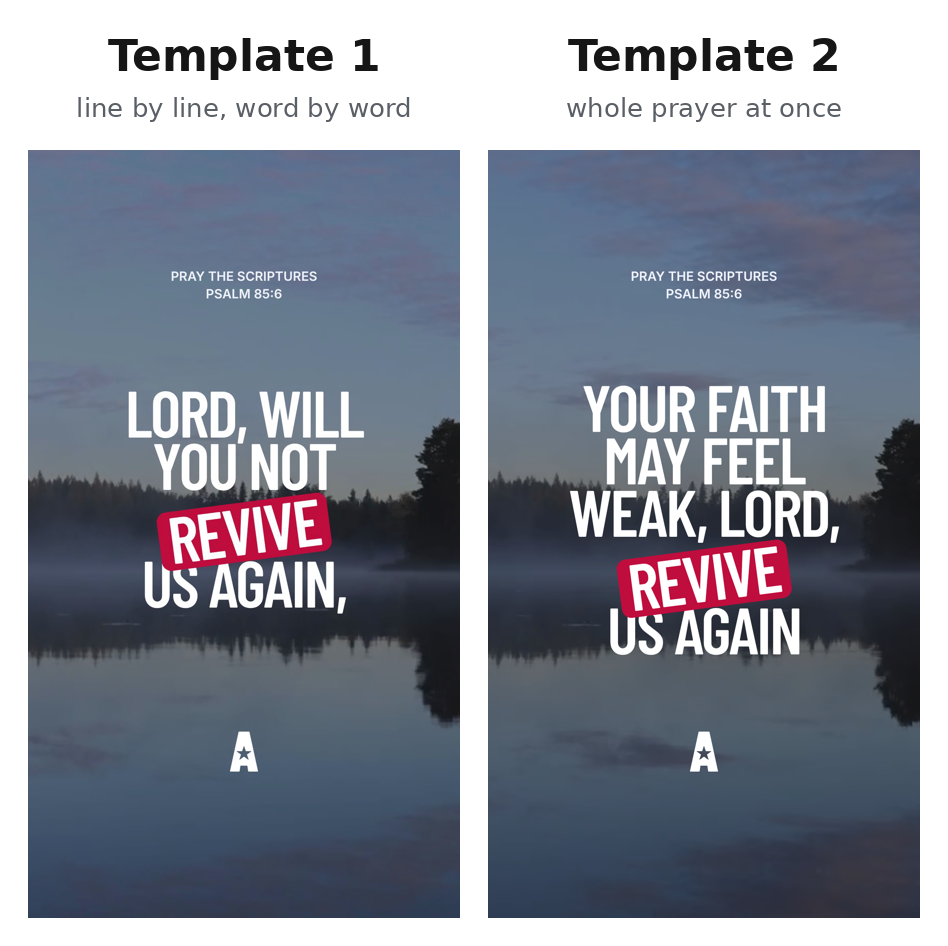
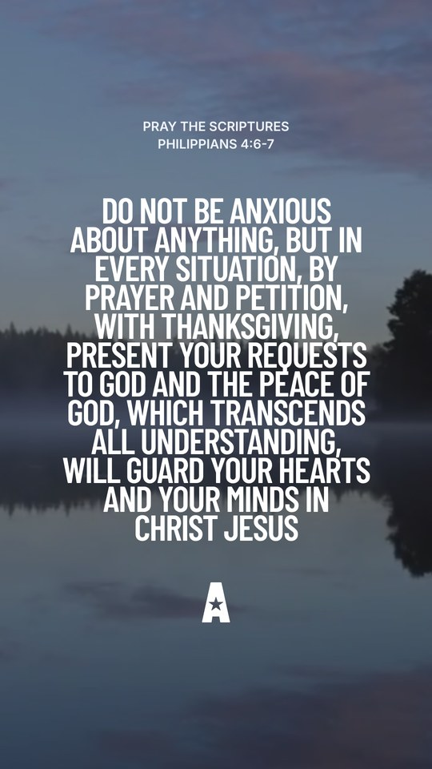

# AA Reels Template

A Claude skill that makes **Awake America prayer reels**: vertical 1080×1920
videos for TikTok, Instagram Reels and YouTube Shorts.

The user opens a chat in Claude, fills in a short form and attaches one or
more photos or videos. Claude sends back a finished MP4 in the AA design (Figma
"Universal Template - Variant 1"): the verse at the top, the prayer in big
uppercase letters, and the "A" icon below.

- **Template 1, line by line:** one line per screen. Each word blurs in as it
  is spoken, and each line blurs out before the next. Long lines are split into
  screens automatically, without changing any words.
- **Template 2, whole prayer at once:** the full prayer is on screen, completely still from start to end, with no highlighted words.
  The size adjusts automatically to fit, up to Template 1's size (164 px).
- words in `*stars*` get the **red accent tag**
- the verse reference and the "A" icon blur in at the start and out at the end
- **several photos or videos** take turns with a soft dissolve (in Template 1,
  during a pause between lines). Photos zoom in and out very slowly; videos loop.
- optional **voiceover** (male or female) and optional calm **music**, both made
  on the spot, with no API keys, subscriptions or licensing





*Template 2 with a long prayer (Philippians 4:6-7): the text shrinks to fit.*

## Install (for the client)

See **[CLIENT-GUIDE.md](CLIENT-GUIDE.md)**: a one-page guide you can send to
the client as it is.

In short:

1. In Claude (claude.ai or the desktop app), open **Settings > Capabilities**
   and turn on **Code execution and file creation**.
2. Download **[`dist/aa-reels.zip`](dist/aa-reels.zip)** (don't unzip it).
3. Go to **Customize > Skills**, click **+**, then **Create skill > Upload a
   skill**, and choose the ZIP.
4. Start a new chat and type: **Make a prayer reel**.

On a Team or Enterprise plan, an owner has to allow skills and code execution
under **Organization settings**.

## The form

```
Template: 1 / 2
Music: On / Off
Voiceover: Yes / No
Voice: Male / Female
Text:
Psalm 85:6
Your faith may feel weak,
Lord, will You not *revive* us again
Amen.
Media Assets: Image / Video
```

- **Text:** the verse reference goes on the first line, then the prayer. In
  Template 1 each line is one screen; lines over 9 words are split
  automatically. Claude never changes the wording.
- **`*stars*`** mark the highlighted word (the red tag). With no stars, Claude
  picks the key word(s) itself (and the script highlights one word as a safety net).
- Full stops are hidden on screen; the voice still pauses at them.
- **Media Assets:** attach one or more photos or videos (up to 10). They take
  turns, in order.

## Timing and requirements

| | |
|---|---|
| First video in a chat | about 2–3 minutes (sets itself up) |
| Each change after that | about 1–2 minutes |
| Network | npm and PyPI (allowed on every plan) and **github.com** (for the voice model). If github.com is blocked, videos still work with Voiceover: No. |
| Video length | Template 1: about 3 seconds per screen. Template 2: about 0.4 seconds per word, at least 6 seconds. |

## Repository layout

```
aa-reels/                 the skill (this folder is what goes in the ZIP)
  SKILL.md                instructions Claude follows: form, rules, changes, errors
  assets/templates.png    the template picture shown to the user
  scripts/make_reel.py    one command: setup, line splitting, voice, music, render, loudness
  scripts/gen_voice.py    Kokoro voiceover + word timing (local, free)
  scripts/gen_music.py    calm piano + strings, made from scratch
  project/                Remotion video project (React)
    src/pray/templates.ts   the templates (positions and sizes from Figma); add new ones here
    src/pray/PhraseText.tsx text layout and auto-size, word blur in/out, red tag
    src/pray/Backgrounds.tsx several photos/videos, crossfades, slow zoom
    src/pray/timing.ts      animation timing constants
dist/aa-reels.zip         ready-to-upload skill
build.sh                  rebuilds dist/aa-reels.zip after changes
```

## Making changes

1. Edit files in `aa-reels/` (for example, animation speed in
   `project/src/pray/timing.ts`, or layout in `project/src/pray/templates.ts`).
2. Run `./build.sh` to rebuild `dist/aa-reels.zip`.
3. Commit and push. The client replaces the skill: in **Customize > Skills**,
   remove the old one and upload the new ZIP.

To test locally (needs Node 18+ and Python 3.10+):

```bash
cat > /tmp/reel.json <<'EOF'
{"template": 1, "music": true, "voiceover": true, "voice": "female",
 "reference": "Psalm 85:6", "phrases": ["Your faith may feel weak,", "Lord, *revive* us again", "Amen."]}
EOF
python3 aa-reels/scripts/make_reel.py --spec /tmp/reel.json --background photo1.jpg clip.mp4 --out reel.mp4
```

## Credits and licences

- Video: [Remotion](https://www.remotion.dev). Free for individuals,
  non-profit organisations and for-profit companies with up to 3 employees;
  larger for-profit companies need a
  [company licence](https://www.remotion.pro/license)
  ([licence text](https://github.com/remotion-dev/remotion/blob/main/LICENSE.md)).
- Voice: [Kokoro-82M](https://github.com/thewh1teagle/kokoro-onnx) (Apache 2.0).
- Fonts: Barlow Condensed and Inter, SIL Open Font License (licence files in
  `aa-reels/project/public/fonts/`).
- Music is generated from scratch by `gen_music.py`, so there are no samples
  and nothing to license.
- Design: Awake America, Figma "AA Mobile App", "Universal Template - Variant 1".
