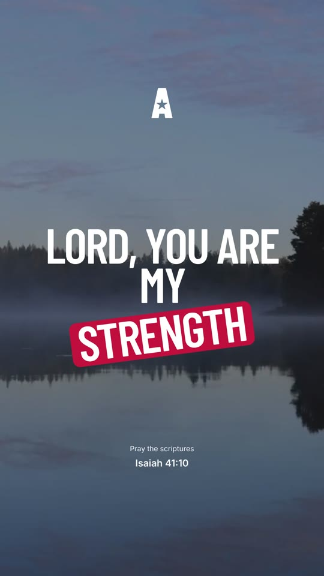

# AA Reels Template

A Claude skill that makes **Awake America prayer reels**: vertical 1080×1920
videos for TikTok, Instagram Reels and YouTube Shorts.

The user opens a chat in Claude, fills in a short form and attaches a photo or
video. Claude sends back a finished MP4:

- one of **three layouts** from the AA design (Figma "Universal Video
  Template"; see `aa-reels/assets/templates.png`)
- the prayer in big uppercase letters, **one line per screen**. Each word blurs
  in as it is spoken, and each line blurs out before the next.
- words in `*stars*` get the **red accent tag**
- the verse reference and the "A" icon blur in at the start and out at the end
- a photo background zooms in and out very slowly; a video background loops
- optional **voiceover** (male or female) and optional calm **music**, both made
  on the spot, with no API keys, subscriptions or licensing




*A frame from a finished reel: Template 3, Isaiah 41:10, `*strength*` highlighted.*

## Install (for the client)

See **[CLIENT-GUIDE.md](CLIENT-GUIDE.md)**: a one-page guide you can send to
the client as it is.

In short:

1. In Claude (claude.ai or the desktop app), open **Settings > Capabilities**
   and turn on **Code execution and file creation**.
2. Download **[`dist/aa-reels.zip`](dist/aa-reels.zip)** (don't unzip it).
3. Go to **Customize > Skills**, click **+**, then **Create skill > Upload a
   skill**, and choose the ZIP.
4. Start a new chat and type: **Make a prayer reel**.

On a Team or Enterprise plan, an owner has to allow skills and code execution
under **Organization settings**.

## The form

```
Template: 1 / 2 / 3
Music: On / Off
Voiceover: Yes / No
Voice: Male / Female
Text:
Psalm 85:6
Your faith may feel weak,
Lord, will You not *revive* us again
Amen.
Media Assets: Image / Video
```

- **Text:** the verse reference goes on the first line, then the prayer, one
  line per screen. Claude never changes the wording.
- **`*stars*`** mark the highlighted word: a red tag in Templates 1 and 3, red
  text in Template 2.

## Timing and requirements

| | |
|---|---|
| First video in a chat | about 2–3 minutes (sets itself up) |
| Each change after that | about 1–2 minutes |
| Network | npm and PyPI (allowed on every plan) and **github.com** (for the voice model). If github.com is blocked, videos still work with Voiceover: No. |
| Video length | about 3 seconds per screen with voiceover |

## Repository layout

```
aa-reels/                 the skill (this folder is what goes in the ZIP)
  SKILL.md                instructions Claude follows: form, rules, changes, errors
  assets/templates.png    the template picture shown to the user
  scripts/make_reel.py    one command: setup, voice, music, render, loudness
  scripts/gen_voice.py    Kokoro voiceover + word timing (local, free)
  scripts/gen_music.py    calm piano + strings, made from scratch
  project/                Remotion video project (React)
    src/pray/templates.ts   the three layouts (positions and sizes from Figma)
    src/pray/PhraseText.tsx word-by-word text, blur in/out, red tag
    src/pray/timing.ts      animation timing constants
dist/aa-reels.zip         ready-to-upload skill
build.sh                  rebuilds dist/aa-reels.zip after changes
```

## Making changes

1. Edit files in `aa-reels/` (for example, animation speed in
   `project/src/pray/timing.ts`, or layout in `project/src/pray/templates.ts`).
2. Run `./build.sh` to rebuild `dist/aa-reels.zip`.
3. Commit and push. The client replaces the skill: in **Customize > Skills**,
   remove the old one and upload the new ZIP.

To test locally (needs Node 18+ and Python 3.10+):

```bash
cat > /tmp/reel.json <<'EOF'
{"template": 1, "music": true, "voiceover": true, "voice": "female",
 "reference": "Psalm 85:6", "phrases": ["Your faith may feel weak,", "Lord, *revive* us again", "Amen."]}
EOF
python3 aa-reels/scripts/make_reel.py --spec /tmp/reel.json --background photo.jpg --out reel.mp4
```

## Credits and licences

- Video: [Remotion](https://www.remotion.dev). Free for individuals,
  non-profit organisations and for-profit companies with up to 3 employees;
  larger for-profit companies need a
  [company licence](https://www.remotion.pro/license)
  ([licence text](https://github.com/remotion-dev/remotion/blob/main/LICENSE.md)).
- Voice: [Kokoro-82M](https://github.com/thewh1teagle/kokoro-onnx) (Apache 2.0).
- Fonts: Barlow Condensed and Inter, SIL Open Font License (licence files in
  `aa-reels/project/public/fonts/`).
- Music is generated from scratch by `gen_music.py`, so there are no samples
  and nothing to license.
- Design: Awake America, Figma "AA Mobile App", section "Universal Video Template".
